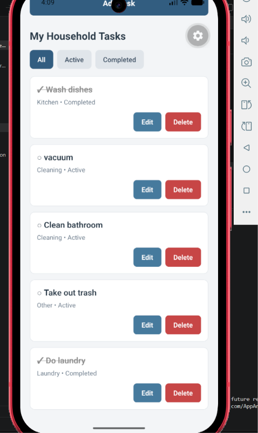
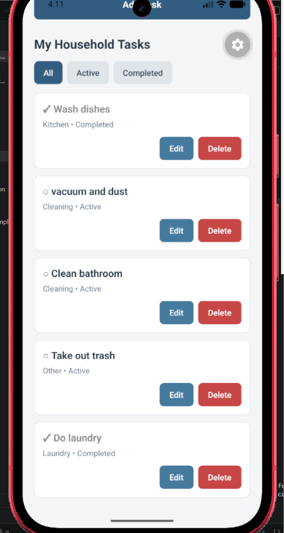
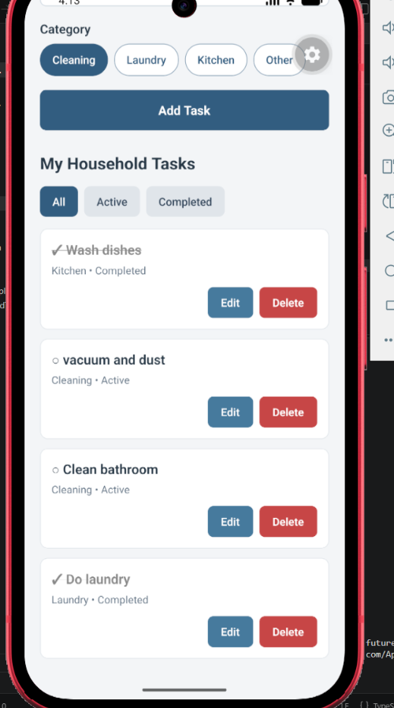
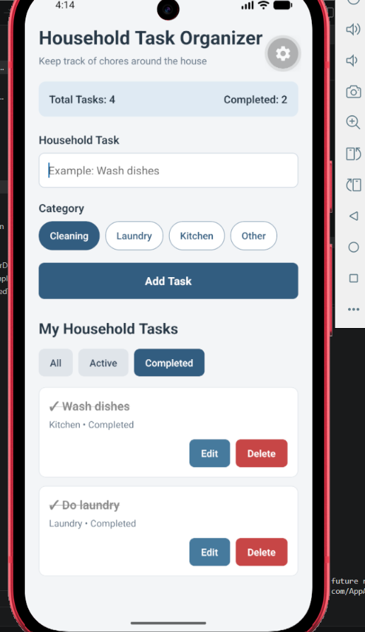
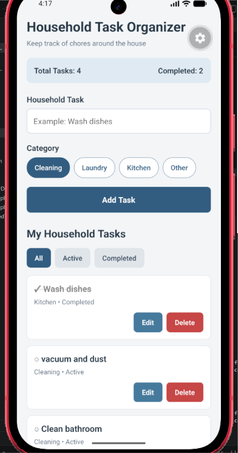

# Household Task Organizer

**Student:** Page Hayes  
**Course:** CMPS460 – Mobile Development  
**Assignment:** Module 7 – Personal Mobile Organizer

## Application Description

The Household Task Organizer is a mobile application I created to help keep track of everyday household chores. It allows users to add tasks, organize them into categories, mark them as completed, and make changes when needed. The goal is to make it easier to stay organized and keep track of what still needs to be done around the house.

## Features

- Add new household tasks.
- View tasks in a list.
- Edit existing tasks and their categories.
- Delete tasks that are no longer needed.
- Mark tasks as completed or active.
- Organize tasks into Cleaning, Laundry, Kitchen, and Other categories.
- Filter tasks by All, Active, or Completed.
- Prevent empty tasks from being added.
- Display the total number of tasks and completed tasks.
- Save tasks using AsyncStorage so they remain available after restarting the app.

## Installation and Running the Application

1. Install Node.js and the Expo development tools.
2. Clone this GitHub repository.
3. Open a terminal inside the `HouseholdTaskOrganizer` project folder.
4. Install dependencies:

   `npm install`

5. Start the Expo development server:

   `npx expo start`

6. Open the application using an Android emulator or a compatible device with Expo Go.

## How AsyncStorage Works

I used AsyncStorage to keep household tasks saved on the device even after the application is closed. When tasks are added, edited, completed, or deleted, the updated list is converted into a JSON string and saved using AsyncStorage.

When the app opens again, it retrieves the saved information and converts it back into a task list. The application uses `useState` to manage task information and `useEffect` to load saved tasks when the application starts and save changes afterward.

I tested this by closing and reopening the application. All four remaining tasks were still there, including the two I had marked as completed.

## Screenshots

### Completed Tasks

### Edited Task

### After Deleting a Task

### Completed Filter

### Tasks Saved After Restarting

## Known Limitations

- The application stores information locally on the device and does not sync tasks between different devices.
- Tasks do not currently have due dates or reminders.
- Filtering is available by completion status, but not by individual category.
- Deleting a task happens immediately without a confirmation message.